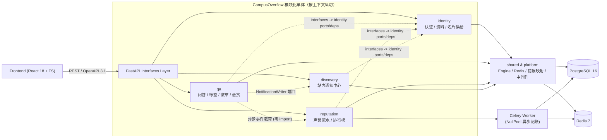

<div align="center">

# CampusOverflow

**面向高校教学场景的校园问答知识社区 —— 沉淀教学答疑，量化学习参与**

[](https://github.com/hbuas-se-2026fall/team09-campus-overflow/actions/workflows/ci.yml)


-brightgreen)

[核心特性](#-核心特性) · [架构设计](#-架构设计) · [API 契约](#-api-契约与端点一览) · [快速开始](#-快速开始) · [质量门禁](#-质量门禁与-ci) · [项目结构](#-目录结构) · [文档索引](#-文档索引)

</div>

---

## 项目简介

**CampusOverflow** 致力于解决高校课程答疑碎片化、历史解答难以检索沉淀、学生学习参与度难以量化评价的问题。学生与教师可以围绕课程标签提问、回答、多维检索与讨论沉淀；系统通过**声誉流水、教师悬赏、连续活跃徽章与周期排行榜**量化贡献，为课程过程性评价提供可靠依据。

> 本项目为《软件工程》课程实践项目，全程按 **DDD（领域驱动设计）** 方法论自主设计与实现，不参考或复制任何开源项目代码。

---

## 核心特性

| 模块 | 已交付能力 |
|:---|:---|
| **身份与认证（`identity`）** | 学生（学号 + 邮箱）/ 教师（工号）分流注册（bcrypt 哈希）；JWT 双令牌（Access 15min + Refresh 7d Redis `GETDEL` 原子轮换与吊销）；登录失败锁定（5 次/15min → `423`）；校园资料局部更新（`UNSET` 哨兵 + 显式 `null` 清空）；HMAC + Redis Lua 邮箱验证码；公开个人名片最小披露与批量展示名供给面 |
| **问答与检索（`qa`）** | 提问（至多 5 个标签）、编辑与终态关闭（关闭后投票/回答/评论/采纳/编辑全冻结）；多维筛选（标签 AND、状态、时区闭区间、`latest`/`votes` 排序）与 `pg_trgm` GIN 全文模糊检索；标签共现相关问题推荐；回答、一人一票防并发投票、一题一采纳（部分唯一索引兜底）；问题/回答评论 |
| **激励与成长（`qa` + `reputation`）** | 教师初始积分与悬赏生命周期（发起冻结 → 采纳结算 → 关贴退款）；Celery 异步声誉记账（`(source, event_id)` 唯一索引幂等 + `acks_late`）；周/月/学期净得分排行榜（`Asia/Shanghai` 窗口 + `RANK()` 竞争排名 + 60s Redis 热榜缓存与故障降级）；实时用户徽章（回答数/采纳率/最长连续活跃） |
| **站内通知（`discovery`）** | 新回答、回答被采纳、新评论同事务幂等写入（跳过自操作）；分页列表、未读筛选、单条/全部已读、未读计数，携带 `question_id` 与实时 `actor_name` |
| **契约与前端（`frontend`）** | 契约优先开发（[openapi.json](openapi.json) 与代码 CI 防漂移校验）；React 18 + TypeScript + Ant Design + React Query + Zustand 实现注册、登录、问题广场、详情互动、提问、标签与个人声誉页 |

---

## 技术栈

| 层次 | 选型 | 说明 |
|:---|:---|:---|
| **后端框架** | Python 3.12+ / FastAPI + Uvicorn | 原生异步、自动生成 OpenAPI 3.1 契约、依赖注入 |
| **数据与迁移** | SQLAlchemy 2.0（async）+ Alembic + PostgreSQL 16 | 异步 ORM 映射、`pg_trgm` GIN 索引、部分唯一/覆盖索引 |
| **缓存与异步** | Redis 7 + Celery | db0 存 Refresh / 登录锁定 / 验证码 / 热榜缓存；db1 作 Celery Broker |
| **校验与日志** | Pydantic v2 + Loguru | `extra="forbid"` 严格入参边界、统一异常分层映射 |
| **前端技术栈** | React 18 + TypeScript 5 + Vite 6 + Ant Design 5 | TanStack React Query 数据同步 + Zustand 状态管理 |
| **工程门禁** | pytest + pytest-cov + ruff + mypy (`--strict`) + Vitest + oxlint | GitHub Actions 双 Job 自动化门禁、8 条 AST 架构护栏 |

---

## 架构设计

### 限界上下文与分层依赖

系统采用**模块化单体 + 限界上下文纵切**架构，各上下文内部严格分为 `domain` / `application` / `infrastructure` / `interfaces` 四层：



### 关键架构决策与工程护栏

| 维度 | 核心机制 | 参考 |
|:---|:---|:---|
| **AST 架构护栏** | [tests/test_architecture.py](tests/test_architecture.py) 强制 8 条静态规则：`domain` 零框架且封闭；`application` 不依赖适配器；`infrastructure` 不入站；跨上下文仅限 `interfaces` 引用对方 `interfaces` 或 `application/ports.py`；`reputation` 对 `qa` 零 `import`；禁裸 `raise ValueError`（统一 `DomainValidationError`） | [ADR-002](docs/adr/ADR-002-context-partition.md) |
| **数据库与并发兜底** | 选用 PostgreSQL 16；投票复合唯一索引 `(user_id, target_type, target_id)`、部分唯一索引保证“一题一采纳”与“每题至多一条开放悬赏”、`for_update` 行锁 + 条件 `UPDATE`、账户余额 `CHECK (balance >= 0)` | [ADR-001](docs/adr/ADR-001-postgresql.md) |
| **连接池与容错分层** | 哨兵连接池 `db_pool_size=0` 走 `NullPool`（测试/CI 零干扰），`>0` 启用 `AsyncAdaptedQueuePool`；连接超时/不可达映射 `503` 可重试，约束冲突映射 `400/409` 且严禁回显驱动异常细节 | [ADR-003](docs/adr/ADR-003-pool-and-capacity.md) |
| **异步声誉与最终一致** | Celery 独立 `NullPool` 引擎 + `task_acks_late=True` + `(source, event_id)` `ON CONFLICT DO NOTHING` 幂等落账；提交先于响应发送（`Depends(get_session, scope="function")`），异步延迟约 0.5–2s | [ADR-004](docs/adr/ADR-004-reputation-celery.md) |
| **读性能与隐私边界** | 用户读路径 4 步 `outerjoin` 单 SQL；公开摘要 `UserSummaryReader` 仅投影非隐私列（绝不连接 `students`/`teachers` 或读出 `email`/`password_hash`） | [F09](docs/test/F09-read-perf-and-trgm.md) · [F11](docs/test/F11-display-name-and-profile.md) |

> 声誉记分规则：回答被赞 `+10`、回答被踩 `-2`、问题被赞 `+5`、问题被踩 `-2`、回答被采纳 `+15`（自投不计分）。

---

## API 契约与端点一览

后端已交付 **31 条路径 / 36 个操作**，契约单源见根目录 [openapi.json](openapi.json)，完整参数与错误码语义见 [docs/api/api-contract-notes.md](docs/api/api-contract-notes.md)。

| 业务域 | 端点摘要 | 关键能力 |
|:---|:---|:---|
| **身份与名片** | 9 个端点 | 注册/登录/刷新/登出、`/auth/me`、局部更新资料、邮箱验证码、公开个人名片 `/users/{id}/profile` |
| **问答与互动** | 15 个端点 | 提问/列表（多维筛选 + `pg_trgm` 搜索）/详情/相关推荐/编辑/关闭/软删除（全链路过滤）、回答（含编辑与软删除）、投票、评论、采纳 |
| **标签/徽章/悬赏/积分** | 5 个端点 | 标签目录、公开用户徽章统计、教师悬赏发起与查询、个人积分余额与流水 |
| **声誉与榜单** | 2 个端点 | 本人声誉流水（他人 `403`）、公开周期排行榜（Redis 60s 缓存 + 实时展示名） |
| **通知与运维** | 5 个端点 | 通知列表/未读数/单条已读/全部已读、`/health` 存活探针 |

<details>
<summary><strong>点击展开全部 31 条路径 / 36 个操作明细</strong></summary>

| 域 | 端点 | 说明 |
|:---|:---|:---|
| 身份 | `POST /api/v1/auth/register` | 学生（学号+邮箱）/ 教师（工号）分流，bcrypt 哈希，重复注册 409 |
| | `POST /api/v1/auth/login` | 学号/工号 + 密码 → JWT 双令牌（失败超限 **423** 临时锁定：5 次/15 分钟窗口，防枚举统一计数） |
| | `POST /api/v1/auth/refresh` | 轮换：旧 Refresh 原子消耗后签发新对 |
| | `POST /api/v1/auth/logout` | 吊销 Refresh，幂等 204 |
| | `GET /api/v1/auth/me` | 当前用户信息（需 Bearer Access，含校园资料与邮箱验证状态） |
| | `PATCH /api/v1/auth/me/profile` | 局部更新 `nickname`/`college`/`class_name`（显式 `null` 清空，200 返回更新后资料） |
| | `POST /api/v1/auth/me/verify-email/send` | 发送 6 位邮箱验证码（60s 冷却 429，已验证 409） |
| | `POST /api/v1/auth/me/verify-email/confirm` | 确认邮箱验证码（幂等 204，错码/过期/5 次作废 400） |
| | `GET /api/v1/users/{user_id}/profile` | 公开个人主页（访客可用，最小披露，不含邮箱与学工号） |
| 问答 | `POST /api/v1/questions` | 发布问题（登录用户，可带至多 5 个标签，返回 `author_name`） |
| | `GET /api/v1/questions` | 列表（访客可用，分页；含 `author_name`，支持 `q` 搜索、`tag`/`status`/创建时间筛选与 `latest`/`votes` 排序） |
| | `GET /api/v1/questions/{question_id}` | 详情（访客可用，答案按采纳优先排序，含标签、`author_name` 与三级评论） |
| | `GET /api/v1/questions/{question_id}/related` | 相关问题推荐（按标签共现，访客可用，含 `author_name`） |
| | `PATCH /api/v1/questions/{question_id}` | 编辑问题（仅提问者；仅标题+正文，部分更新；已关闭 409） |
| | `DELETE /api/v1/questions/{question_id}` | 软删除问题（仅提问者；作者重复删幂等 204；已有采纳答案 409；联动退还开放悬赏） |
| | `PATCH /api/v1/answers/{answer_id}` | 编辑回答（仅回答者本人；已关闭 409；返回新正文、净票数、`author_name` 与完整评论） |
| | `DELETE /api/v1/answers/{answer_id}` | 软删除回答（仅回答者本人；父问题活跃时重复删幂等 204；已采纳 409） |
| | `POST /api/v1/questions/{question_id}/close` | 关闭问题（仅提问者，终态；重复关闭/已采纳 409；未采纳悬赏全额退款） |
| | `POST /api/v1/questions/{question_id}/answers` | 发布回答（返回 `author_name`） |
| | `POST /api/v1/questions/{question_id}/vote` | 问题投票（顶/踩） |
| | `POST /api/v1/questions/{question_id}/answers/{answer_id}/vote` | 回答投票（重复票/改票一律 409） |
| | `POST /api/v1/questions/{question_id}/comments` | 问题评论（返回 `author_name`） |
| | `POST /api/v1/answers/{answer_id}/comments` | 回答评论（返回 `author_name`） |
| | `POST /api/v1/answers/{answer_id}/accept` | 采纳最佳答案（仅提问者，非作者 403 / 重复采纳 409；联动结算悬赏） |
| 标签 | `GET /api/v1/tags` | 标签目录（访客可用，码点序、同名唯一归并） |
| 徽章 | `GET /api/v1/users/{user_id}/badges` | 用户徽章与活跃统计（公开；回答数/采纳率/最长连续活跃） |
| 悬赏 | `POST /api/v1/questions/{question_id}/bounty` | 发起教师悬赏（仅教师 403；关闭/已采纳/余额不足/重复悬赏 409） |
| | `GET /api/v1/questions/{question_id}/bounty` | 查询进行中的悬赏（公开；无则 `null`） |
| 积分 | `GET /api/v1/users/me/points` | 查询本人可消费积分余额与流水（需登录；教师首次访问惰性发放 100 分） |
| 声誉 | `GET /api/v1/users/{user_id}/reputation` | 本人声誉总值与变动流水（他人 403） |
| 榜单 | `GET /api/v1/leaderboard` | 声誉排行榜（公开；`week`/`month`/`semester`；含 `display_name`，60s 热榜缓存，Redis 故障降级直查库） |
| 通知 | `GET /api/v1/notifications` | 本人通知列表（分页 + 未读筛选，含 `actor_name` 与可选 `question_id`） |
| | `GET /api/v1/notifications/unread-count` | 未读通知数 |
| | `POST /api/v1/notifications/{notification_id}/read` | 单条标记已读（幂等 204） |
| | `POST /api/v1/notifications/read-all` | 全部标记已读 |
| 运维 | `GET /health` | 存活探针（无 DB 依赖） |

</details>

---

## 快速开始

### 环境要求

- **Python** `3.12+`
- **Docker**（用于拉起 PostgreSQL 16 + Redis 7）
- **Node.js** `22+` 与 **pnpm** `10+`（仅前端需要）

### 方式一：Windows 一键启动器（推荐本地体验）

双击仓库根目录 `CampusOverflow-Launcher.exe`（或运行 [scripts/launcher/campus_launcher.ps1](scripts/launcher/campus_launcher.ps1)），自动执行：拉起 `db`/`redis` → `alembic upgrade head` → 分窗启动 API / Celery Worker / 前端 → 打开浏览器（自动避让 Windows Hyper-V 动态保留端口）。

仅做环境与端口自检：

```powershell
.\scripts\launcher\campus_launcher.ps1 -Check
```

### 方式二：手动启动前后端

#### 1. 安装后端依赖并拉起基础设施

```powershell
python -m venv .venv
.\.venv\Scripts\Activate.ps1
pip install -r requirements-dev.txt

# 启动 PostgreSQL 16 + Redis 7（等待 healthcheck 通过）
docker compose up -d
```

#### 2. 配置环境变量（可选）

开发期各字段均带默认值；如需覆盖，可复制 [.env.example](.env.example) 为 `.env`（**严禁将个人 `.env` 提交入库**）：

- `APP_ENV`（`dev`/`test`/`prod`）：`prod` 模式下使用默认 `EMAIL_VERIFY_HMAC_SECRET` 或未配置完整 SMTP 会启动 fail-fast。
- `DB_PORT` / `REDIS_PORT`：Windows 若 `5432` / `6379` 落入 Hyper-V 保留段，可改用 `15432` / `16379` 并同步修改 `DATABASE_URL`、`REDIS_URL`、`CELERY_BROKER_URL`。
- `DB_POOL_SIZE`：`0` 走 `NullPool`（默认），`>0` 启用连接池（见 [ADR-003](docs/adr/ADR-003-pool-and-capacity.md)）。

#### 3. 执行迁移并启动服务

```powershell
# 迁移脚本变更须先人工审核后再 upgrade
alembic upgrade head

# 终端 A：启动 FastAPI
uvicorn app.main:app --host 127.0.0.1 --port 8123

# 终端 B：启动声誉异步 Celery Worker（Windows 须使用 --pool=solo）
celery -A app.contexts.reputation.infrastructure.celery_app:celery_app worker --pool=solo -l info
```

启动后访问：
- Swagger UI：`http://127.0.0.1:8123/docs`
- OpenAPI 契约：`http://127.0.0.1:8123/openapi.json`
- 存活探针：`http://127.0.0.1:8123/health`

#### 4. 启动前端开发服务器

```powershell
cd frontend
pnpm install
pnpm dev          # Vite 默认代理 /api -> http://localhost:8123（可用 VITE_API_TARGET 覆盖）
```

---

## 质量门禁与 CI

仓库通过 [.github/workflows/ci.yml](.github/workflows/ci.yml) 在每次 `push(main)` 与 `pull_request` 执行 `ci` 与 `frontend` 双 Job 门禁：

| 端 | 门禁项 | 命令 | 当前实测结果 |
|:--|:--|:--|:--|
| 后端 | Lint | `ruff check .` | **0 违规** |
| 后端 | 严格类型检查 | `mypy app` | `--strict` **0 错误**（146 文件） |
| 后端 | 单元测试 + 总覆盖率 | `pytest -m "not integration" --cov=app --cov-report=term-missing --cov-fail-under=70` | **366 passed**，总覆盖率 **82.76%**（≥ 70%） |
| 后端 | 核心聚合覆盖率 | `python -m coverage report --include="*/domain/*" --fail-under=90` | **94%**（≥ 90%） |
| 后端 | OpenAPI 防漂移 | `python scripts/export_openapi.py --check` | 与 [openapi.json](openapi.json) 一致（31 paths / 36 ops） |
| 后端 | 定向集成回归 + 真实冒烟 | 定向 6 文件集成回归 + 真实 Uvicorn 冒烟 | 集成回归 **22 passed**；冒烟 **8/8 PASS**（全量集成待按需运行） |
| 前端 | 类型 / 测试 / 构建 / Lint | `pnpm run typecheck && pnpm run test && pnpm run build && pnpm run lint` | 由 `frontend` Job 门禁保障 |

---

## 目录结构

```text
CampusOverflow/
├── app/
│   ├── main.py                         # FastAPI 组装、中间件与全局异常处理器注册
│   ├── config/settings.py              # Pydantic Settings（.env 覆盖）
│   ├── platform/http/                  # 请求体上限、错误映射、函数级会话依赖
│   ├── shared/                         # Engine / Redis / 文本校验 / 异常基类 / UNSET 哨兵
│   └── contexts/                       # DDD 限界上下文（每上下文含 domain/application/infrastructure/interfaces）
│       ├── identity/                   # 注册 / 登录 / JWT / RBAC / 校园资料 / 邮箱验证 / 公开名片（F09–F11）
│       ├── qa/                         # 问题（pg_trgm 检索）/ 回答 / 投票 / 采纳 / 评论 / 标签 / 徽章 / 悬赏 / 积分
│       ├── reputation/                 # 声誉流水 + 排行榜（Redis 缓存 + 展示名）+ Celery 记账（F05/F08/F11）
│       └── discovery/                  # 站内通知中心（F04/F11）
├── alembic/                            # 数据库版本化迁移脚本（当前 head：c90363e3c1fb）
├── frontend/                           # React 18 + TypeScript 5 + Vite 6 前端工程
├── tests/                              # 架构护栏 / 契约防漂移 / 单元 / 集成 / 验收测试
├── scripts/                            # OpenAPI 导出与校验脚本、Windows 一键启动器源码
├── docs/                               # 进度表、ADR、领域模型、Sprint 工件、测试台账与工程标准
├── openapi.json                        # OpenAPI 3.1 单源接口契约
├── docker-compose.yml                  # 本地 PostgreSQL 16 + Redis 7 编排
└── CampusOverflow-Launcher.exe         # Windows 一键启动器
```

---

## 里程碑与特性进展

| 阶段 | 主题 | 状态 |
|:---|:---|:---|
| 阶段 0 | 工程重启（工具链 / DDD 骨架 / CI / Docker Compose） | **完成** |
| 阶段 1 | Sprint 1 文档（故事地图 / Backlog / Gherkin / 领域模型） | **完成** |
| 阶段 2 | Walking Skeleton（注册 → 登录 → 提问 → 列表 → 详情 + 契约交付） | **完成** |
| 阶段 3 | 核心特性（回答 / 投票 / 采纳 / 评论 / 标签 / 声誉 + Celery / 测试冲刺 / 迭代 5 治理） | **完成** |
| 增量特性 A/B | `F01–F13`（筛选 / 搜索 / 相关推荐 / 通知 / 榜单 / 徽章 / 悬赏 / 热榜缓存 / 读性能与 `pg_trgm` / 资料与邮箱验证 / 展示名供给与个人主页 / 编辑回答 / 软删除与全链路过滤） | **已交付** |
| 后续规划 | `F14–F18`（二级评论 / RBAC 扩展 / 课程上下文 / 内容审核）与阶段 4 上线（`F19–F20`） | 规划中 |

---

## 文档索引

| 文档 | 内容 |
|:---|:---|
| [docs/PROGRESS.md](docs/PROGRESS.md) | 里程碑状态与逐条工程变更记录 |
| [docs/plan/f-engineering-standard.md](docs/plan/f-engineering-standard.md) | F 系列工程标准、六步法 SOP 与 F01–F20 规划总表 |
| [docs/adr/](docs/adr) | 4 份架构决策记录（ADR-001 至 ADR-004） |
| [docs/domain/](docs/domain) | 限界上下文图、聚合清单、统一语言术语表 |
| [docs/api/api-contract-notes.md](docs/api/api-contract-notes.md) | 前端消费指南、错误形态速查与接口语义口径 |
| [docs/sprint/](docs/sprint) | 故事地图、Product Backlog、Gherkin 验收标准、PR 评审与 Retro |
| [docs/test/](docs/test) | 各阶段与 F01–F12 开发测试台账（含并发竞态与暴力测试实证） |
| [docs/plan/phase3-plan.md](docs/plan/phase3-plan.md) | 阶段 3 实施计划 v3 |

---

## 当前版本

`v0.1.0` —— 阶段 0–3 已收口，F 系列增量特性已交付 **F01–F12**（阶段 4 容器化上线待推进）。
